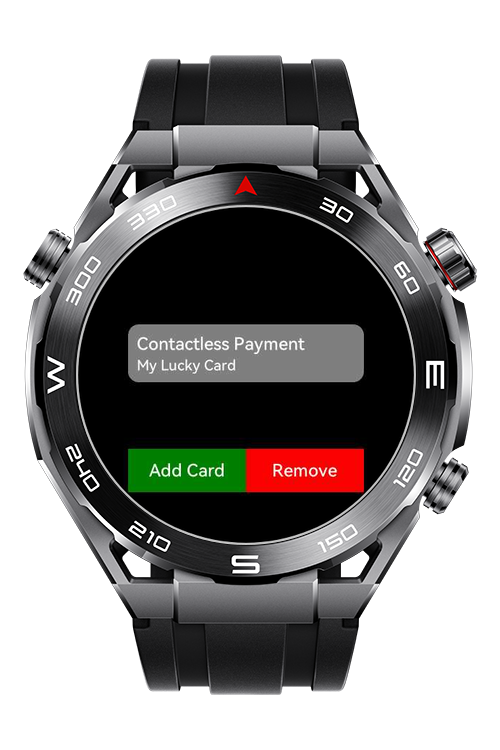
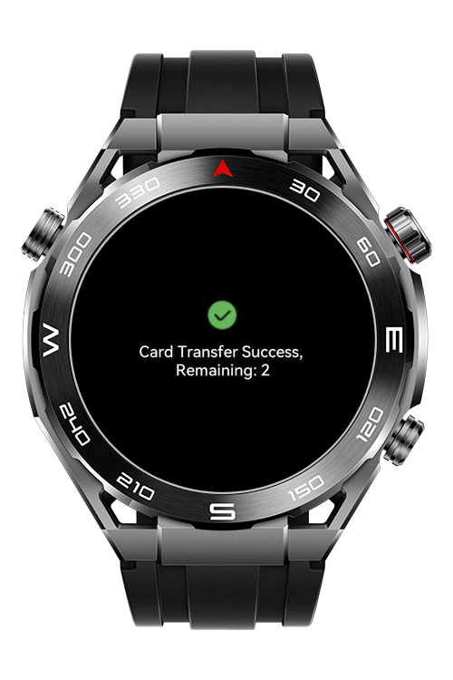
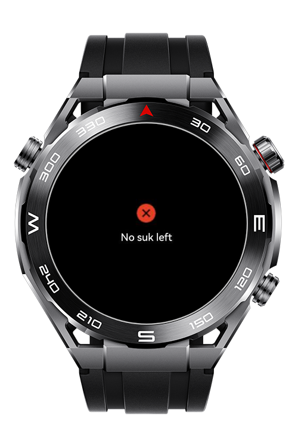

> **Note:** To access all shared projects, get information about environment setup, and view other guides, please visit [Explore-In-HMOS-Wearable Index](https://github.com/Explore-In-HMOS-Wearable/hmos-index).

# How To Use HCE

This app shows how to implement hce payment feature.

# Preview

<div>
  
  
  
  
</div>

# Use Cases

- Use NFC to make payments.

# Technology

## Stack

- **Languages**: HML, JS
- **Frameworks**: 4.0.0(10)
- **Tools**: DevEco Studio Version 5.1.1.830
- **Libraries**:
    - @ohos.router
    - @system.storage
    - @system.file
    - @ohos.nfc.cardEmulation

## Required Permissions

- `ohos.permission.NFC_CARD_EMULATION`
  > To make payment

# Directory Structure

```
entry/src/main/js/MainAbility
│   app.js
│   
├───common
│   ├───img
│   │       checkmark_circle_fill.png
│   │       xmark_circle_fill.png
│   └───js
│           router.js
├───pages
│   ├───cardTransferSuccess
│   │       cardTransferSuccess.css
│   │       cardTransferSuccess.hml
│   │       cardTransferSuccess.js
│   ├───index
│   │       index.css
│   │       index.hml
│   │       index.js
│   └───noSuk
│           noSuk.css
│           noSuk.hml
│           noSuk.js
└───util
        dataStore.js
        hce.js
        keyStore.js
```

# Constraints and Restrictions

## Supported Device

- Huawei Sport (Lite) Watch GT 4/5/6
- Huawei Sport (Lite) GT4/5 Pro
- Huawei Sport (Lite) Fit 3/4
- Huawei Sport (Lite) D2
- Huawei Sport (Lite) Ultimate

# License

**How To Use HCE** is distributed under the terms of the MIT License
See the [LICENSE](./LICENSE) for more information.